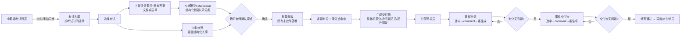
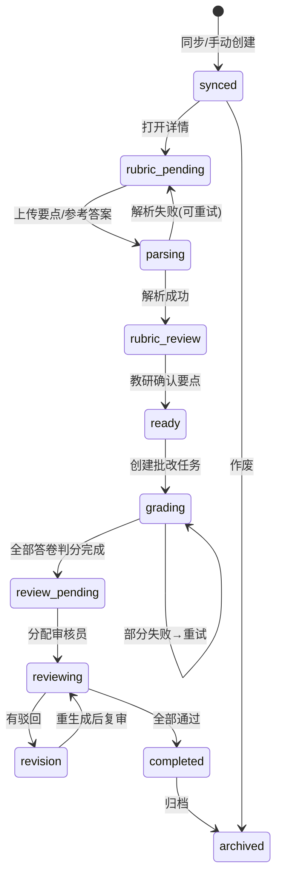

# 遴选 AI 教研中台 · 需求梳理

> 状态：v0.1 草案（待教研/审核业务方确认）
> 日期：2026-11-12
> 范围：只做需求、接口、数据模型、部署与工程规范的梳理，不含业务代码实现。
> 现有基线：本仓库已有一个可运行的 Demo（Next.js 15 + Elysia + Drizzle + PostgreSQL + AI SDK 5 + CopilotKit），见根目录 `README.md`；架构图与业务流程图见 `../../.archify/`。

---

## 0. 一句话定位

把机构里"一场考试 → 几百份主观题答卷 → 逐份判分 + 逐份点评 + 提分建议"的人工教研产线，变成一条**可编排、可审核、可追溯、可计费**的 AI 流水线；教研老师管"标准"，审核员管"质量"，平台管"权限、成本、数据"。

它不是一个"AI 批改工具"，而是一个**多租户的教研生产中台**：考试和答卷是原料，评分要点是工艺标准，语料库是知识资产，审核记录是质量凭证。

---

## 1. 结论先行：10 条关键决策

| # | 决策 | 理由 | 影响 |
|---|---|---|---|
| D1 | **第一天就做多租户**（`tenant_id` 贯穿全表 + RLS） | "SaaS 中台"意味着未来卖给多家机构/多校区，后补租户字段是灾难性重构 | 所有表、所有接口、所有缓存键都带 tenant |
| D2 | **页面可见性与功能权限分开建模** | 用户要求"每个页面对每个用户组的可见性"；但"能看见页面"≠"能操作数据" | `pages` 注册表 + `role_pages` 矩阵；API 另有 `权限点 + 数据范围` |
| D3 | **AI 输出一律结构化落库，不存"一段大文本"** | 要支持选中片段提 comment、增量重生成、版本 diff、回滚 | 判分落到"题 × 采分点"，交付物落到"段落 block" |
| D4 | **判分层与表达层分离** | 重写"提升建议"的措辞不应改变分数；分数是事实，文案是表达 | `grades` 与 `artifacts` 两套表、两套版本 |
| D5 | **AI 解析出的评分要点必须人工确认才生效** | 评分依据错一次，整场几百份全错，返工成本极高 | 考试状态强制经过 `rubric_review`，确认动作记审计 |
| D6 | **批改是异步长任务，队列与 API 分离** | 一场 300 份 × 多题，不可能在 HTTP 请求里跑完 | 独立 worker（pg-boss），SSE 推进度，幂等键防重复扣费 |
| D7 | **comment 用"锚点"定位，不用纯文本** | 纯文本匹配会漂移；锚点才能精准重生成指定片段 | 锚点 = 目标类型 + 目标 id + 题号/block id + 字符区间 + 原文引用 |
| D8 | **语料库是"检索 + 模板 + 人工维护"的资产，不是向量库** | 教研老师要能改、能停用、能看命中 | 条目表 + pgvector 检索 + 引用回填（哪条语料被哪次生成用了） |
| D9 | **Prompt 与模型配置进数据库并版本化** | 模型会换、话术会调，硬编码在代码里等于每次发版 | `prompt_templates/versions`、`models`，支持灰度与回滚 |
| D10 | **约束 AI 写代码靠"可执行检查"，不靠提示词自觉** | 提示词是软约束，lint/test/CI 才是硬约束 | 每条规则都要能映射到一个 lint 规则、测试或 CI 门禁（见 05 篇） |

**必须先拍板的一个语义歧义**：需求第 2 步说"解析完评分要点后，场次状态流转到待审核"，第 5 步又说"把待审核的考试分配给审核员"。这两处的"待审核"如果指同一状态，就会出现"还没批改就让人审核"的空转。

本方案拆成两个状态：

- `rubric_review`（待审核评分要点）：教研老师确认 AI 解析结果；
- `review_pending`（待分配审核）：批改完成、有判分和交付物可审。

如果业务上确实希望"分配审核员"和"批改"并行（边批边审），也可以支持，但需要明确审核员在批改未完成时能看到什么（建议：只看已完成部分，且不允许通过整场）。**这条需要确认。**

---

## 2. 角色、权限与数据范围

### 2.1 角色（用户组）

| 角色 key | 名称 | 典型人员 | 核心职责 | 数据范围 |
|---|---|---|---|---|
| `platform_admin` | 平台超管 | SaaS 运营方 | 租户开通、套餐、全局配置、跨租户排障 | 全租户 |
| `org_admin` | 机构管理员 | 机构负责人/教务主管 | 用户与用户组、页面可见性、集成配置、用量 | 本租户全部 |
| `teacher` | 教研老师 | 学科教研 | 同步考试、维护试卷与评分要点、发起批改、维护语料库与 Prompt、终审交付 | 本租户全部考试 |
| `reviewer` | 审核员 | 内部骨干/外聘兼职 | 判分审核、交付物审核、提 comment、通过/驳回 | 只限分配给自己的答卷 |
| `ops` | 运营/客服 | 班主任 | 查看进度、导出交付物、催办 | 本租户只读 + 导出 |
| `student` | 学员 | 考生 | 微信内查看本人批改结果 | 仅本人 |

> 角色可自定义：`roles` 表按租户建，内置角色标记 `is_system=true` 不可删。权限点是全局固定的枚举（代码里定义，DB 里只做分配），避免出现"配了一个系统不认识的权限"。

### 2.2 三层权限模型

```
页面可见性（能不能进这个路由）
  └─ 功能权限（这个接口/按钮能不能点）
       └─ 数据范围（能看到哪些行：全租户 / 我参与的 / 分配给我的 / 仅本人）
```

- **页面可见性**：`pages` 注册表（代码中 manifest 为准）+ `role_pages` 矩阵（DB 覆盖）。未授权访问返回 404 而非 403，避免暴露页面存在。
- **功能权限**：权限点形如 `exam:read`、`grading:run`、`review:approve`、`corpus:write`、`admin:page`。Elysia 路由声明所需权限，插件统一校验；同时导出成 OpenAPI 的 `x-permission` 扩展，供前端生成按钮级控制。
- **数据范围**：审核员默认 `assigned`；教研老师 `tenant`；学员 `self`。范围在 repository 层拼 where，不靠前端过滤。

### 2.3 页面可见性矩阵（后台可配）

管理员页面提供"页面 × 用户组"的开关矩阵，支持按角色模板一键套用、变更预览（"该角色将隐藏 6 个菜单"）、变更留审计。默认模板见 `01-pages.md` 第 4 节。

---

## 3. 端到端业务流程与状态机

### 3.1 主流程（对应需求的 1–7 步 + 语料库）



### 3.2 场次（Exam）状态机



| 状态 | 含义 | 谁推进 | 允许的下一步 |
|---|---|---|---|
| `synced` | 已从平台同步，缺评分依据 | 系统/教研 | 补要点、作废 |
| `rubric_pending` | 待上传评分依据 | 教研 | 上传解析 |
| `parsing` | AI 解析中（异步） | 系统 | 成功/失败重试 |
| `rubric_review` | 解析完成待人工确认 | 教研 | 编辑后确认、重新解析 |
| `ready` | 标准就绪，可批改 | 教研 | 发起批改 |
| `grading` | 批改中 | 系统 | 完成、中止、重试 |
| `review_pending` | 待分配审核 | 教研/管理员 | 分配 |
| `reviewing` | 审核中 | 审核员 | 通过、驳回 |
| `revision` | 有驳回待重生成 | 系统/审核员 | 重生成后回 `reviewing` |
| `completed` | 全部通过，可交付 | 教研 | 导出/交付、归档 |
| `archived` | 归档/作废 | 管理员 | — |

### 3.3 答卷（AnswerSheet）与交付物（Artifact）状态

- 答卷：`pending`（未批改）→ `grading` → `graded`（已判分）→ `reviewing` → `revision`（有未解决 comment）→ `approved`（审核通过）→ `delivered`；异常 `failed`。
- 交付物：`draft` → `generating` → `pending_review` → `revising` → `approved` → `delivered`，每次重生成产生新 `version`，旧版本保留可 diff、可回滚。
- 两者是"一拖多"：一份答卷 1 套判分 + 1 组交付物（问题分析/总览/提升建议，也允许拆成多个 artifact）。

### 3.4 关键业务规则（写进代码前必须先对齐）

1. **一份答卷多次作答**：小鹅通允许重复考。默认取"最后一次提交"，`attempt_no` 入库；是否允许人工指定某次为有效，待确认。
2. **批改范围**：只批"未批改"，已判分的默认跳过；重批需要显式勾选并记录原因（会计入成本）。
3. **分数口径**：题目分 `numeric(5,1)`，总分由采分点累加后与题目满分取 `min`；人工改分必须填原因，且生成 `grade_versions`。
4. **审核通过粒度**：按"答卷"通过，还是按"题"通过？建议按答卷整体通过，但单题可标记"已确认"，避免一题一卡。
5. **交付物与判分的一致性**：交付物里引用的分数、题号、失分点，必须来自 `grades` 的结构化数据，不允许模型自由发挥；生成后用规则校验（见 05 篇的 AI 基线）。
6. **成本归属**：每次 AI 调用记 `ai_usage_logs`（租户/用户/场次/用途/token/金额），场次详情展示本场成本。

---

## 4. 范围边界

**做（MVP → V1）**

- 微信登录、用户组、页面可见性、审计；
- 小鹅通考试/考卷/答卷同步（含手动同步与定时同步）；
- 评分要点上传 → AI 解析 → 人工校对 → 结构化入库；
- 批量批改（异步队列、进度、重试、成本）；
- 交付物生成（问题分析/总览/提升建议）+ 引用语料库；
- 审核分配、comment、批量/增量重生成、版本 diff、通过/驳回；
- 语料库 CRUD、导入导出、向量化与检索测试；
- 导出 DOCX/PDF；交付记录；
- 模型/Prompt 配置、用量看板。

**暂不做（但要留接口）**

- 学生端完整产品（先做只读 H5 结果页）；
- 在线支付/套餐计费（先做用量统计，计费二期）；
- 自动判客观题（小鹅通已有成绩的直接复用）；
- 视频/直播课程相关能力；
- 多语言；
- 私有化部署（架构上保证可私有化，不专门做安装包）。

**明确不做**

- 替代小鹅通做考试系统（不做组卷、发卷、防作弊）；
- 做公考题库/搜题（不自建题库内容）。

---

## 5. 里程碑与人力估算

| 里程碑 | 内容 | 预估 | 验收标准 |
|---|---|---|---|
| M0 基座 | 多租户、RBAC、页面矩阵、微信登录、文件上传、审计、CI 基线 | 10 人日 | 换角色能看到不同菜单；越权接口 403；CI 全绿 |
| M1 接入 | 小鹅通考试/考卷/答卷同步、试卷结构化、评分要点解析与校对 | 12 人日 | 一场真实考试能完整入库并确认要点 |
| M2 批改 | 队列、批改编排、判分落库、交付物生成、成本统计 | 15 人日 | 100 份答卷 15 分钟内批完，失败可重试 |
| M3 审核 | 分配、审核台、comment、增量重生成、diff、通过/驳回 | 15 人日 | 审核员可只重生成被 comment 的片段 |
| M4 资产与交付 | 语料库、Prompt 版本、导出、交付记录 | 8 人日 | 教研可自助增删语料并影响生成结果 |
| M5 SaaS 化 | 租户开通、配额、计费、开放 API | 待定 | 第二家机构可独立开通使用 |

> 按 2 名全栈 + 1 名前端 + 0.5 名测试估算，M0–M4 约 3 个月。这里的人日只含开发，不含业务方校对评分要点、验收 AI 效果的时间。

---

## 6. 待确认问题（按优先级）

| # | 问题 | 为什么重要 | 默认假设（未确认时按此执行） |
|---|---|---|---|
| Q1 | 小鹅通已开通哪些接口权限集？是否提供"考试列表/考卷详情/学员答卷/交卷消息推送"？答卷是文本还是图片？ | 决定 M1 是 2 周还是 2 个月；图片要走 OCR（百度智能云） | 假设有考试+答卷查询接口，答卷含图片，需 OCR |
| Q2 | "待审核"到底指审核评分要点，还是审核批改结果？两者能否并行？ | 决定状态机与页面 | 拆成两个状态，串行 |
| Q3 | 交付渠道：导出 DOCX 人工上传？H5 链接？小鹅通站内信/课程关联？ | 决定交付模块与合规（学员个人信息暴露面） | 先做 DOCX/PDF 导出 + 只读 H5 链接 |
| Q4 | 一家机构还是多家？多校区是否要独立数据？ | 租户粒度 | 租户=机构，校区用标签 |
| Q5 | 审核员是内部还是外聘？是否按件计酬？ | 影响审核台（计件、结算）与权限 | 内部+外聘，先不做结算 |
| Q6 | 峰值量：每月多少场、每场多少份、单份多少题/多少字？ | 决定并发、模型选型、成本 | 30 场/月，300 份/场，5 题，单份 1500 字 |
| Q7 | 是否允许数据出境（用海外模型）？ | 学员答卷是个人信息，涉及合规 | 只用境内模型，海外模型仅备案后可选 |
| Q8 | 主观题评分是否需要"双评+仲裁"（两名审核员独立打分）？ | 影响分配算法与状态机 | 先单评，预留 `review_round` |
| Q9 | 是否需要与现有教务/CRM 对接？ | 影响同步模块抽象 | 先只接小鹅通 |
| Q10 | 是否要过等保二级/密评？ | 影响部署与采购 | 按等保二级要求设计，暂不测评 |

---

## 7. 文档索引与现有资产

| 文档 | 内容 |
|---|---|
| [`01-pages.md`](./01-pages.md) | 页面清单、导航结构、关键页面交互、页面可见性默认模板 |
| [`02-api.md`](./02-api.md) | 接口规范、116 个接口清单、关键契约、错误码、SSE |
| [`03-database.md`](./03-database.md) | 表结构、枚举、索引、RLS、迁移策略 |
| [`04-platforms-and-deploy.md`](./04-platforms-and-deploy.md) | 平台 Key（百度 OCR / DeepSeek 4.1 Flash / 微信 / 小鹅通）、成本、部署拓扑（Vercel + 阿里云 RDS）、上线 Runbook、合规与迁移 |
| [`05-engineering-baseline.md`](./05-engineering-baseline.md) | 提示词约束体系、Baseline 指标、CI/CD 流水线、DoD；**§15 为当前执行的工作约定（笔记位置 / 不写 e2e / 功能先文档 / 提交前 CR / 流式 + Generative UI）** |
| [`../features/README.md`](../features/README.md) | 新功能的需求文档 + 开发计划模板与索引 |
| [`../codereviews/README.md`](../codereviews/README.md) | 提交前 CR 报告的模板与索引 |

**可复用的现有资产**

- 可运行 Demo：`../../README.md`（Next.js 15 + Elysia 1.4 + Drizzle + PostgreSQL + AI SDK 5 + CopilotKit，含 SSE 流式与归档）。
- 系统架构图：`../../.archify/architecture-xs-ai-platform-20261112-145308/xs-ai-platform-architecture.html`
- 业务流程图：`../../.archify/workflow-ai-grading-20261112-145941/ai-grading-workflow.html`

> 这两张图已经覆盖了分层架构、审核双阶段、队列与状态机，本文档与之保持术语一致（如 `pg-boss`、`rubric`、`artifact`）。
