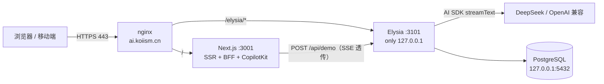
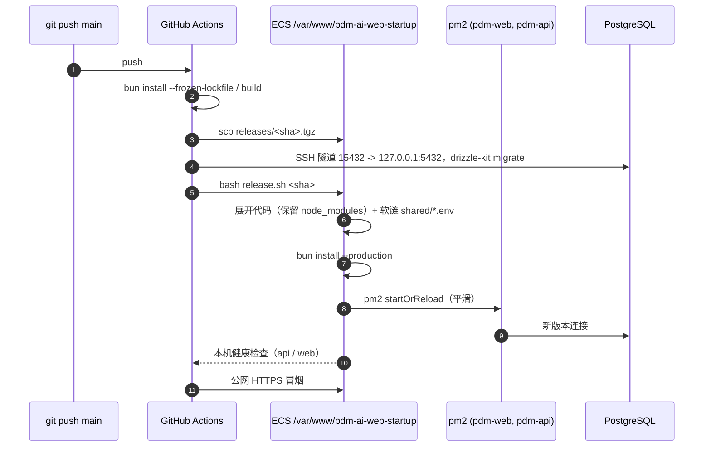

# PDM AI Web Startup

面向「公务员遴选教培」场景的 **AI Web 项目启动模板**：Bun monorepo + Next.js 15（App Router / BFF）+ Elysia 1.4 + Drizzle + PostgreSQL + AI SDK 5 + CopilotKit。

开箱包含一条完整的业务纵切（输入备考目标 → AI **SSE 逐字流式**拆解为可执行任务清单 → 自动归档），以及一套**真正跑在生产上**的交付链路：GitHub Actions 构建、阿里云 ECS 发布、pm2 守护、nginx + Let's Encrypt、`deploy-ops` 运维 Skill（部署 / 回滚 / 日志 / `.env` 同步）。

> 现网参考部署：**https://ai.koiism.cn**（阿里云 ECS 8.140.27.125，北京，2C2G，Alibaba Cloud Linux 3）

---

## 1. 它解决什么问题

新起一个 AI Web 项目时，重复劳动集中在三处：前后端分离的类型契约、流式 AI 的用户体验、以及上线运维。这个模板把三件事都钉死：

| 关注点   | 模板给的做法                                                                                               |
| -------- | ---------------------------------------------------------------------------------------------------------- |
| 类型契约 | Elysia `t` 模型是唯一声明来源；`App` 类型经 Eden Treaty 传到前端，零手写 DTO                               |
| 流式体验 | 服务端 SSE（`meta/delta/todos/done/error`）+ Next 同源 BFF 转发，不缓冲字节                                |
| 上线运维 | GitHub Actions 构建 → scp 发布包 → SSH 隧道迁移 → pm2 平滑重载 → 冒烟；本地用同一个 CLI 复现               |
| 配置安全 | 敏感值只在 `.agents/skills/deploy-ops/.env`（已 gitignore）与服务器 `shared/*.env`，不进仓库、不进 CI 日志 |

---

## 2. 技术栈

| 层              | 选型                                                                         |
| --------------- | ---------------------------------------------------------------------------- |
| 运行时 / 包管理 | Bun 1.2（workspace + `bun.lock`）                                            |
| Web             | Next.js 15.5（App Router、RSC、Tailwind CSS 4、shadcn/ui 风格组件、Zustand） |
| API             | Elysia 1.4（TypeBox 校验、OpenAPI、CORS）                                    |
| 数据            | PostgreSQL 16/17 + Drizzle ORM（`bun:sql` 原生驱动，无 `pg` 依赖）           |
| AI              | AI SDK 5（`streamText`）+ OpenAI 兼容网关（默认 DeepSeek）+ CopilotKit 1.50  |
| 部署            | pm2 + nginx + Let's Encrypt；GitHub Actions 做构建与发布                     |

---

## 3. 架构



同源设计的两点取舍：

- **浏览器只认一个域名**。业务流式走 `/api/demo`（Next 路由转发，不暴露 Elysia 地址）；Eden Treaty 的基址是 `/elysia`，由 nginx 反代到 `:3101`。
- **API 不监听公网**。Elysia 绑 `127.0.0.1:3101`，5432 同理；公网只有 nginx 的 80/443。

---

## 4. 目录结构

```
.
├── apps
│   ├── server                     # Elysia API（Bun）
│   │   ├── drizzle/               # 生成的 SQL 迁移 + meta
│   │   ├── src
│   │   │   ├── app.ts             # 组装 CORS / OpenAPI / 错误处理
│   │   │   ├── index.ts           # 监听入口，导出 App 类型给 Eden
│   │   │   ├── env.ts             # 环境变量收敛点
│   │   │   ├── db/                # Bun.sql + Drizzle + schema + repository
│   │   │   ├── lib/llm.ts         # OpenAI 兼容 provider
│   │   │   └── modules/demo       # controller / service / model / prompt
│   │   └── tests
│   └── web                        # Next.js 15 App Router
│       └── src
│           ├── app/api/demo       # 同源 SSE 转发（BFF）
│           ├── app/api/copilotkit # CopilotKit runtime
│           ├── components/demo    # Hero / 工作台 / 清单 / 归档 / Copilot
│           ├── lib                # Eden 客户端、SSE hook
│           └── store              # Zustand
├── packages/shared                # 前后端共享类型 + Task 解析器
├── deploy/ecosystem.config.cjs    # pm2 进程定义（pdm-web / pdm-api）
├── .agents/skills/deploy-ops      # 部署·运维·.env 同步 Skill（见第 10 节）
├── .github/workflows              # ci.yml + deploy.yml
├── docker-compose.yml             # 本地 PostgreSQL
└── scripts/setup-env.ts           # 首次生成 .env
```

服务端遵循 Elysia 官方推荐的 feature-based MVC：

| 文件                      | 职责                                                       |
| ------------------------- | ---------------------------------------------------------- |
| `modules/demo/index.ts`   | Controller：路由、校验、HTTP 状态码、SSE Response          |
| `modules/demo/service.ts` | Service：LLM 编排、流式、解析、归档；不接触 Elysia Context |
| `modules/demo/model.ts`   | Model：TypeBox `t` 单一来源，运行时校验 + TS 类型          |
| `modules/demo/prompt.ts`  | Prompt 资产                                                |
| `db/demo-repository.ts`   | 持久化边界，独立于 HTTP 层                                 |

---

## 5. 快速开始（本地）

环境要求：Bun ≥ 1.2、Node ≥ 20（Next 用）、PostgreSQL ≥ 15 或 Docker。

```bash
bun install              # 1) 装依赖（monorepo 在根目录装一次）
bun run setup:env        # 2) 生成 apps/server/.env 与 apps/web/.env.local
bun run db:up            # 3) 起本地 PostgreSQL（或用自己的实例）
bun run db:migrate       # 4) 建表
bun run db:seed          # 5)（可选）插一条示例归档
bun run dev              # 6) 并行起 web + api
```

`.env` 里至少填 `LLM_API_KEY`，否则 `POST /api/demo` 会返回 503（健康检查显示 `llm: missing-key`）。

| 入口          | 地址                                  |
| ------------- | ------------------------------------- |
| 首页 / 工作台 | http://localhost:3000                 |
| 演示页        | http://localhost:3000/demo            |
| 同源流式入口  | `POST http://localhost:3000/api/demo` |
| Elysia API    | http://localhost:3101                 |
| 健康检查      | http://localhost:3101/api/health      |
| OpenAPI UI    | http://localhost:3101/openapi         |

> 后端默认 **3101**（避开常见的 3001 冲突）；生产上 web 用 3001、api 用 3101，改端口见 `.agents/skills/deploy-ops/.env`。

---

## 6. 接口

### `POST /api/demo` → `text/event-stream`

```json
{ "goal": "三个月内通过省直机关遴选笔试" }
```

| event   | data                                         |
| ------- | -------------------------------------------- |
| `meta`  | `{ runId, model, startedAt }`                |
| `delta` | `{ text }` — 逐字增量                        |
| `todos` | `{ todos: TodoItem[] }` — 清单条数变化时推送 |
| `done`  | `{ runId, todos, latencyMs, persisted }`     |
| `error` | `{ message, runId? }`                        |

```bash
curl -N -X POST http://localhost:3101/api/demo \
  -H 'Content-Type: application/json' \
  -d '{"goal":"30 天补齐公文写作短板"}'
```

### 其它

| 方法  | 路径                 | 说明                                         |
| ----- | -------------------- | -------------------------------------------- |
| `GET` | `/api/health`        | `status / database / llm / model / uptimeMs` |
| `GET` | `/api/demo/runs`     | 最近 8 条归档（库挂了优雅降级为 `[]`）       |
| `GET` | `/api/demo/runs/:id` | 单条记录 + 完整清单                          |
| `GET` | `/openapi`           | OpenAPI UI（JSON 在 `/openapi/json`）        |

关键实现细节：BFF 透传不缓冲、`parseTodos` 前后端共用、数据库 best-effort（掉线仍可生成，`done.persisted=false`）、客户端 `AbortController` 一路传到 AI SDK 的 `abortSignal`，中断的 run 落库为 `failed`。

---

## 7. 环境变量

本地：`apps/server/.env`、`apps/web/.env.local`（由 `bun run setup:env` 生成）。

生产：**不在 CI 里配**。它们由 `.agents/skills/deploy-ops` 从 `.env` 渲染到服务器的 `shared/server.env` 与 `shared/web.env.local`，再软链进 release。

| 变量                         | 位置         | 说明                                             |
| ---------------------------- | ------------ | ------------------------------------------------ |
| `PORT` / `HOST`              | server       | 生产固定 `3101` / `127.0.0.1`                    |
| `CORS_ORIGIN`                | server       | 逗号分隔允许来源                                 |
| `DATABASE_URL`               | server       | PostgreSQL 连接串（生产指向 `127.0.0.1:5432`）   |
| `LLM_BASE_URL` / `LLM_MODEL` | server + web | OpenAI 兼容网关 / 模型 id                        |
| `LLM_API_KEY`                | server + web | 只存在于服务端；浏览器不接触                     |
| `NEXT_PUBLIC_API_URL`        | web          | **build 期内联**，生产为 `https://<域名>/elysia` |
| `API_INTERNAL_URL`           | web          | BFF 转发目标，`http://127.0.0.1:3101`            |

> `NEXT_PUBLIC_*` 会被打进客户端包：**换域名必须重新构建**（CI 每次构建都会用当前 `PUBLIC_ORIGIN` 覆盖）。

---

## 8. 根目录脚本

| 脚本                                                                       | 说明                           |
| -------------------------------------------------------------------------- | ------------------------------ |
| `bun run dev` / `dev:web` / `dev:server`                                   | 并行 / 单独启动                |
| `bun run build` / `build:web` / `build:server`                             | 构建（CI 只用这两条）          |
| `bun run start` / `start:web` / `start:server`                             | 生产模式启动                   |
| `bun run typecheck`                                                        | 全 workspace `tsc --noEmit`    |
| `bun run test` / `test:watch`                                              | 服务端 Bun 测试                |
| `bun run lint`                                                             | Next ESLint                    |
| `bun run format` / `format:check`                                          | Prettier                       |
| `bun run db:generate` / `db:migrate` / `db:push` / `db:studio` / `db:seed` | Drizzle 工具链                 |
| `bun run db:up` / `db:down`                                                | Docker Compose 启停 PostgreSQL |
| `bun run setup` / `setup:env`                                              | 装依赖 + 生成 env 文件         |
| `bun run clean` / `openapi`                                                | 清理产物 / 打开 OpenAPI        |

---

## 9. CI / CD：GitHub → 阿里云 ECS

两个工作流，职责分开：

| 工作流                         | 触发                          | 内容                                                      |
| ------------------------------ | ----------------------------- | --------------------------------------------------------- |
| `.github/workflows/ci.yml`     | PR、push main                 | typecheck → test → lint → format → build → 产物自检       |
| `.github/workflows/deploy.yml` | push main（忽略纯文档）、手动 | 构建 → 打包 → scp → 迁移 → 切换 release → pm2 重载 → 冒烟 |

### 发布链路



设计要点：

- **构建只在 CI 做**。2C2G 的 ECS 跑 `next build` 会被 OOM killer 干掉（控制台也会提示内存风险）；服务器只做「装运行时依赖 + 起进程」。
- **迁移走 SSH 隧道**，不把 5432 暴露到公网，也不需要 `drizzle-kit` 装到服务器上。
- **release 目录化 + 只保留最近 5 个包**：回滚就是「换一个 tarball 再切一次」，40G 盘不会被历史包吃满。
- **`.env` 不进发布包**：tarball 里没有 `apps/*/.env*`，服务器靠 `shared/` 软链，重建 release 不会丢配置。

### 需要配置的 Secrets（仓库 Settings → Secrets and variables → Actions）

| 名称                 | 必填               | 说明                                                          |
| -------------------- | ------------------ | ------------------------------------------------------------- |
| `DEPLOY_HOST`        | ✅                 | `8.140.27.125`                                                |
| `DEPLOY_USER`        | ✅                 | `root`                                                        |
| `DEPLOY_SSH_KEY_B64` | ✅（二选一，优先） | 私钥的 base64（`base64 -w0 < id_ed25519`），无换行、不怕 CRLF |
| `DEPLOY_SSH_KEY`     | ✅（二选一）       | 私钥全文（含 `BEGIN/END`），仅在没配 B64 时使用               |

数据库密码与 LLM Key **不需要**进 GitHub：迁移时 CI 从服务器 `shared/server.env` 读取，经隧道使用。

### 首次上线（一次性）

```bash
cd .agents/skills/deploy-ops
cp .env.example .env          # 填 DEPLOY_HOST / DB_PASSWORD / DATABASE_URL / LLM_API_KEY
mkdir -p .ssh && vim .ssh/id_ed25519   # 放部署私钥（或直接复用已有的）
node scripts/ops.mjs doctor   # 自检
node scripts/ops.mjs bootstrap --domain ai.koiism.cn   # 目录 / bun / swap / PG / pm2 / nginx + 证书
node scripts/ops.mjs env sync # 渲染并下发 apps/*/.env
```

然后把公钥加到服务器 `~/.ssh/authorized_keys`、把私钥存进 GitHub Secrets，push 到 `main` 即自动发布。

---

## 10. 部署与运维 Skill：`.agents/skills/deploy-ops`

一个自包含的 Skill（SKILL.md + 脚本 + `.env`），把「发布 / 回滚 / 看日志 / 同步 `.env`」变成一条命令。CI 用它，人也用它——同一套实现。

```bash
node .agents/skills/deploy-ops/scripts/ops.mjs doctor          # 自检
node .agents/skills/deploy-ops/scripts/ops.mjs deploy          # 本地构建 + 发布（CI 用 --skip-build）
node .agents/skills/deploy-ops/scripts/ops.mjs env sync        # 改完 .env 后同步到服务器并重载
node .agents/skills/deploy-ops/scripts/ops.mjs status|logs|restart|rollback|smoke|db|ssh
```

**敏感信息只在一处**：`.agents/skills/deploy-ops/.env`（已 gitignore）。详见 [`.agents/skills/deploy-ops/SKILL.md`](.agents/skills/deploy-ops/SKILL.md)。

---

## 11. 数据库

```
demo_runs                       demo_todos
  id uuid pk                      id uuid pk
  goal text                       run_id uuid fk → demo_runs.id (cascade)
  model varchar(80)               title text
  status enum                     detail text
    (streaming|completed|failed)  priority varchar(16)
  raw_output text                 position int
  todo_count int                  created_at timestamptz
  latency_ms int
  error text
  created_at timestamptz
  completed_at timestamptz
```

改 schema：`bun run db:generate` → `bun run db:migrate`；上线由 CI 的隧道迁移完成，**迁移必须向前兼容**（expand → 双写/回填 → contract）。

---

## 12. 已知边界

- 单租户 Demo：没有登录、组织、RBAC、配额。
- CopilotKit 用最小 runtime，会话不落库。
- 归档支持回看，尚不支持删除 / 导出 PDF / 任务状态回写。
- 生产环境只有一台 ECS（无 LB、无多可用区）；备份依赖 PostgreSQL 自身与云盘快照。
- 同一台机器上还跑着其他站点（例如 `:3000` 的旧应用），本项目用独立端口、独立目录、独立 nginx `server_name`，互不影响。
